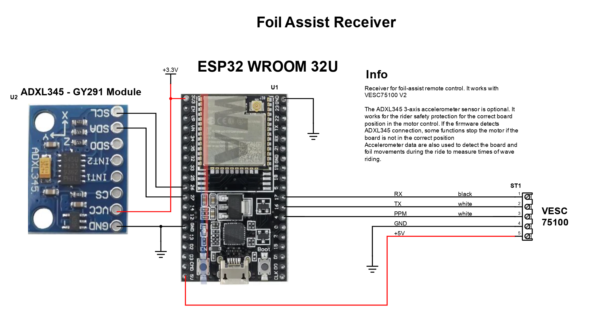
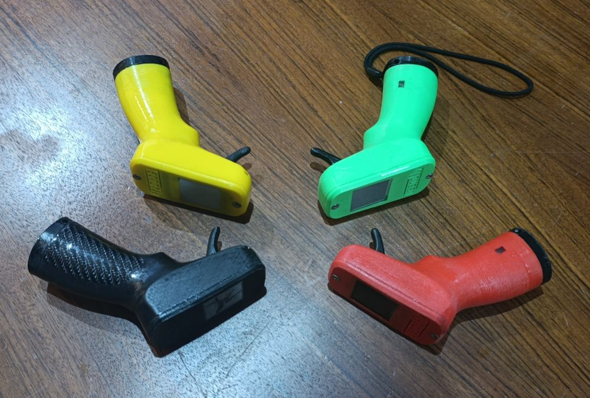
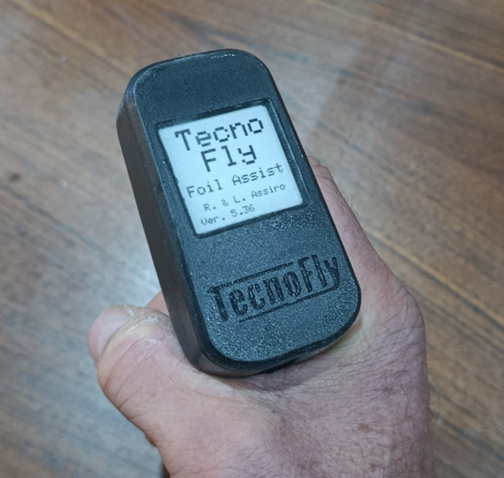
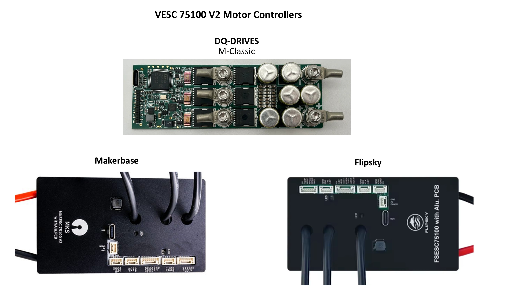

# TecnoFly — VESC Management System for Foil Assist

**A control layer between the rider and the VESC: telemetry in, throttle out, parameters under control.**

> Project website: [www.foilassistproject.com](http://www.foilassistproject.com)

---

## What this is

Most e-foil builds treat the VESC as a black box: you set it once with VESC Tool on a laptop, then you ride. This project does something different. The board-mounted ESP32 sits **between the rider and the motor controller**, and treats the VESC as a device to be read, understood and adjusted — at the bench, on the water, from a phone.

The repository contains two firmwares:

- **Transmitter** — handheld controller (ESP32-C3), Hall-effect throttle, ePaper display, talks to the board over ESP-NOW
- **Receiver** — board-mounted ESP32 WROOM, wired to the VESC over UART and PPM, hosting a Wi-Fi hotspot with a full web interface

Everything below is about the receiver, because that is where the VESC management actually lives.

---

## Architecture

```
   ┌─────────────────┐        ESP-NOW          ┌──────────────────────┐
   │   TRANSMITTER   │  throttle, settings →   │       RECEIVER       │
   │    ESP32-C3     │ ← telemetry, limits     │    ESP32 WROOM 32U   │
   │  ePaper display │      (2.4 GHz)          │  LittleFS + Wi-Fi AP │
   └─────────────────┘                         └──────────┬───────────┘
                                                          │ UART 115200
                                                          │ + PPM
                                               ┌──────────▼───────────┐
                                               │     VESC 75100       │
                                               │  mc_configuration    │
                                               └──────────────────────┘
```

The remote sends throttle and configuration requests. The receiver owns the VESC: it polls it, filters it, logs it, exposes it on a web page, and writes back the parameters it is allowed to touch. **The receiver is the source of truth; the remote is a terminal.**

---

## 1. Telemetry

The receiver polls the VESC over UART once per second (`COMM_GET_VALUES`) and keeps a live model of the machine:

| Channel | Use |
|---|---|
| Input voltage | state of charge, battery alarm, cutoff protection |
| Motor and battery current | power computation, thermal and current limits |
| Electrical power (W) | throttle ceiling, ride statistics |
| MOSFET temperature | thermal protection |
| ERPM / mechanical RPM | propeller speed, take-off detection |
| Watt-hours counter | energy per session, battery percentage |
| Fault code | decoded and written to the event log with a human-readable name |

Everything is mirrored to the remote display and to the web interface, and **logged once per second to a binary file** (22 bytes per record, packed struct) together with throttle, board attitude and accelerometer data.

Two consumers read that log:

- **Ride summary** — max power, max current, minimum voltage, max temperature, average power, energy, rider score
- **Ride analysis** — take-offs, foil sessions, best continuous foil time, falls

The binary format is deliberate: 22 bytes per sample against ~48 for CSV, so a one-hour session is about 79 KB instead of 173 KB, on a flash that also holds the web pages.

### Session statistics

A session is one battery. Because swapping the battery means power-cycling the board, the peak values (`maxPower`, `maxCurrent`, `minVoltage`, `maxTemp`) are **kept for the whole session** and reset only at boot. A long pause on the water does not restart the statistics.

---

## 2. Throttle control

The control path is kept as short as possible:

```
trigger → ADC → ESP-NOW packet → receiver callback → PPM value → VESC
```

The throttle is written to the ESC **inside the ESP-NOW receive callback**, not in the main loop: latency stays under a millisecond even while the board is busy logging, serving web pages or talking to the VESC.

On top of the raw path:

- **Throttle curve** — configurable gamma and mix, applied in the receiver before the ESC write, linear by default
- **Power ceiling** — `l_watt_max` is enforced on the VESC side; the receiver keeps the value aligned and can lower it live
- **Link timeout** — no packet for 1500 ms means throttle zero, motor stopped
- **Tilt cutoff** — with the accelerometer fitted, an out-of-range board attitude stops the motor
- **Direct cut** — an abrupt movement stops the propeller and holds it for 3 seconds
- **Reverse and speed limits** — ERPM ceiling and rotation direction are parameters, not firmware constants

### Remote menu

The transmitter carries its own settings menu, so the rider never needs a phone on the water:

```
SETUP MODE
 - Pair
 - Display
 - Power      →  Power (watt ceiling)  |  Motor type (BLDC / FOC)  |  Back
 - Propeller
 - Firmware   →  Controller  |  Board  |  Back
 - Exit
```

**Power → Motor type** selects the motor preset and writes it to the VESC through the receiver.
**Firmware → Controller** updates only the remote. **Firmware → Board** sends the setup trigger that puts the receiver into update mode — and only that entry sends it.

---

## 3. Parameter management

This is the part that makes the project different from a throttle bridge.

### 3.1 Snapshot: reading the VESC into a file

The receiver asks the VESC for its complete motor configuration (`COMM_GET_MCCONF`), receives the binary `mc_configuration` (483 bytes on firmware 6.06), and stores it on the internal filesystem as a snapshot.

```
GET /dumpAndSaveVesc     → read the VESC, save into the active file, report the byte count
GET /mcconf.bin          → download the BLDC snapshot
GET /focconf.bin         → download the FOC snapshot
GET /readMcconf          → load the snapshot into the working buffer
```

The snapshot is written **exactly as received** — 483 bytes, no padding. A file larger than that is a legacy dump and is reported as such in the web interface.

### 3.2 Two presets: BLDC and FOC

The receiver keeps **two complete configurations** and lets you move between them:

| File | Mode | Typical use |
|---|---|---|
| `/mcconf.bin` | BLDC | the default motor setup |
| `/focconf.bin` | FOC | a different motor, different tuning |

Only one is active at a time, and the choice is stored in EEPROM, so it survives a power cycle. Switching preset and programming the VESC are **two separate actions**:

- **Select** — changes which file is active. It does not touch the VESC.
- **Program** — sends the active file to the VESC. The web interface blocks it if the file does not exist.

From the remote menu, choosing BLDC or FOC does both: switch and program.

```
GET /motorConfig           → active preset, which files exist, their size, firmware build
GET /motorConfig?set=0|1   → select the preset (0 = BLDC, 1 = FOC)
GET /motorConfig?program=1 → write the active preset to the VESC
```

### 3.3 Editing a subset of parameters

Not everything is exposed — only what is meaningful to change from a phone. The rest stays as the VESC Tool left it.

| Parameter | Offset | Meaning |
|---|---|---|
| `l_current_max` | 8 | motor current limit (A) |
| `l_current_min` | 12 | regenerative current limit (A) |
| `l_in_current_max` | 16 | battery current limit (A) |
| `l_in_current_min` | 20 | battery regen limit (A) |
| `l_abs_current_max` | 28 | absolute current ceiling (A) |
| `l_min_erpm` | 32 | minimum ERPM |
| `l_max_erpm` | 36 | maximum ERPM |
| `l_battery_cut_start` | 54 | voltage where power starts to fade (V × 10) |
| `l_battery_cut_end` | 56 | voltage where power is cut (V × 10) |
| `l_temp_fet_start` | 63 | MOSFET derating temperature (°C) |
| `l_temp_fet_end` | 64 | MOSFET cutoff temperature (°C) |
| `l_temp_motor_start` | 84 | motor derating temperature (°C) |
| `l_max_duty` | 100 | maximum duty cycle |
| `l_watt_max` | 73 | electrical power ceiling (W) |
| `m_invert_direction` | 416 | propeller rotation direction |

Read path:

```
GET /vescParam            → the current values as plain text, for the web form
```

Write path:

```
GET /vescParams?l_current_max=80&l_in_current_max=81&…
```

The receiver loads the active snapshot, patches the fields, saves it back, rebuilds the `COMM_SET_MCCONF` packet with a proper CRC, sends it, and waits for the VESC acknowledgement. If the controller reboots (which it does, and that is normal), the receiver probes it until it answers again.

### 3.4 Verification

Believing that a write succeeded is not the same as knowing it. The receiver can read the configuration back from the VESC and compare it **byte by byte** with the active file:

```
GET /vescVerify
→ {"ok":true,"match":true,"diff":0,"bytes":483,"path":"/focconf.bin"}
→ {"ok":true,"match":false,"diff":12,"bytes":483,"path":"/mcconf.bin"}
```

If the write failed, or a different configuration is actually running, you see the number of differing bytes instead of a guess. The web interface runs the check automatically a few seconds after programming.

### 3.5 Why the offsets matter

`mc_configuration` is a packed C struct serialised in **big-endian** order, and its layout is tied to the VESC firmware version. The offsets above are correct for **6.06**. That is exactly why the firmware refuses to write anything unless the version check passes:

```
isVescFirmware606() == false  →  write refused, reason logged
```

A wrong layout would produce a corrupt configuration on a controller that drives a propeller. The version gate is not bureaucracy, it is the safety interlock.

### 3.6 Power ceiling from the remote

The remote can lower the power limit while riding:

```
GET /vescPower            → current watt ceiling
GET /vescPower?w=1800     → set a new one
```

The same value can be adjusted from the transmitter menu. Requests from the remote and from the web interface converge on the same writer, so the two never fight: the last explicit change wins, and repeated values are ignored.

---

## 4. Web interface

The receiver raises a Wi-Fi hotspot and serves a complete interface from LittleFS — no app, no cloud, no account:

| Page | Purpose |
|---|---|
| `index.html` | system status, links |
| `rides.html` | last 10 rides, summary cards and comparison charts |
| `ride.html` | single ride: charts and phase analysis |
| `expert.html` | VESC management: presets, dump, edit, program, verify, memory health |
| `setup.html` | system settings, throttle calibration |
| `test.html` | live sensor monitor |
| `viewer.html` | offline `.bin` viewer, served separately |

VESC-related endpoints:

| Endpoint | Method | Purpose |
|---|---|---|
| `/vescFwVersion` | GET | firmware version of the connected VESC |
| `/dumpAndSaveVesc` | GET | snapshot the VESC into the active file |
| `/vescParam` | GET | read the active snapshot as text |
| `/vescParams` | GET | write a subset of parameters to the VESC |
| `/vescPower` | GET | read/write the power ceiling |
| `/readMcconf` | GET | reload the active snapshot into memory |
| `/flashMcconf` | GET | send the active snapshot to the VESC |
| `/motorConfig` | GET | presets: state, select (`?set=`), program (`?program=1`) |
| `/vescVerify` | GET | compare the VESC with the active file |
| `/mcconf.bin`, `/focconf.bin` | GET | download the snapshots |
| `/heap` | GET | memory state: ok / WARN / LOW with free and minimum |

---

## 5. Diagnostics

A control system that fails silently is worse than one that fails loudly. Three mechanisms exist for that.

### Boot reason

Every start writes one line to the event log with the reset cause:

```
BOOT reason=power-on
BOOT reason=BROWNOUT
BOOT reason=PANIC
BOOT reason=TASK_WDT
```

`power-on` is normal. `BROWNOUT` means a supply problem — connector, vibration, current spike. `PANIC` is a software crash. `TASK_WDT` means a task stopped responding.

### Memory monitor

RAM is checked every 10 seconds and reported with three states, two thresholds:

| State | Free heap | Meaning |
|---|---|---|
| `ok` | ≥ 60 KB | healthy margin |
| `WARN` | 20 – 60 KB | margin tightening |
| `LOW` | < 20 KB | allocation failures are likely |

A line is written **only when the state changes**, with 5 KB of hysteresis, so a quiet session produces no noise and a bad one produces two or three lines:

```
HEAP ok boot free=132K min=131K
HEAP WARN run free=38K min=35K
```

The minimum reached since boot is the number that predicts failures; the web interface shows it live in `expert.html`.

### Event log discipline

The log lives on flash, and flash writes block. Two rules keep it harmless:

- **Rate limit** — at most four events per second, and identical messages within 3 seconds are dropped
- **Rotation** — the file is trimmed at 30 KB, so a full rewrite happens rarely instead of on every line

Without those, a log call from a fast loop can starve the control task — the motor stops, Wi-Fi disappears, and the board looks dead until the battery is pulled.

---

## 6. Safety rails

The firmware is built around the idea that a wrong write on a motor controller is worse than a missing feature.

- **Firmware gate** — parameters are written only if the VESC reports 6.06
- **Preset gate** — programming is refused if the selected file does not exist
- **CRC on every packet** — VESC protocol CRC16-CCITT, both directions
- **ACK / NACK handling** — a rejected write is reported, not assumed
- **UART mutex** — telemetry, dumps and writes never interleave on the same serial line
- **Config mutex** — one writer at a time on the configuration buffer
- **EEPROM sovereignty** — after boot, the receiver aligns to the remote but does not obey repeated values; settings change only on a real change
- **Link timeout** — no throttle packets, no motor
- **Bounded event log** — logging cannot starve the control loop

---

## 7. Repository layout

```
foil-assist-controller/
├── transmitter/            # ESP32-C3 firmware (handheld remote)
│   ├── esp32-foil-TX-V5.ino
│   ├── menu.ino            # on-device menu: pairing, power, motor, propeller, firmware
│   ├── display-data.ino    # ePaper rendering
│   ├── hall.ino            # throttle acquisition and calibration
│   └── download.ino        # OTA updates, controller/board selection
├── receiver/               # ESP32 WROOM firmware (board-mounted)
│   ├── esp32-foil-RX.ino   # setup, loop, event log, boot reason, memory monitor
│   ├── vesc_data.ino       # telemetry polling and session statistics
│   ├── vescPowerLimit.ino  # presets, parameter patching, write and verify
│   ├── vescConfigDump.ino  # snapshot from the VESC
│   ├── data_binary.ino     # binary ride logging
│   ├── ride_analysis_binary.ino  # take-offs, foil sessions, best time
│   ├── json.ino            # ride summary and live JSON
│   ├── api.ino             # HTTP endpoints
│   └── data/               # web interface (LittleFS)
└── images/
```

---

## 8. Getting started

1. **Hardware** — build the transmitter and receiver following the schematics in `images/`.
2. **Flash the receiver** with the ESP32 Arduino core (3.x), then upload the `receiver/data` folder to LittleFS.
3. **Flash the transmitter** and set the receiver MAC address.
4. **Wire the VESC** — UART RX/TX to the receiver, PPM signal for throttle, common ground.
5. **Update the VESC to firmware 6.06** with VESC Tool before using the parameter features.
6. **Snapshot** — connect to the board hotspot, open `expert.html`, press *Dump from VESC into selected file*. Now you have a restorable copy of your configuration.
7. **Second preset** — set the VESC up for FOC, select `focconf.bin`, dump again. You now hold both configurations.
8. **Verify** — press *Verify VESC vs selected file* and read the result: matching, or the number of differing bytes.
9. **Ride** — data is logged automatically and visible in `rides.html` after the session.

---

## 9. Hardware


*Receiver schematic — ESP32 WROOM 32U wired to a VESC 75100*


*UART and PPM connection between the receiver and the controller*


*3D-printed transmitter housings*


*ePaper display: battery, power, ride data*

Full hardware detail, schematics and STL files are linked from the project website.

---

## 10. VESC compatibility

| Controller | Status |
|---|---|
| Makerbase 75100 V2 | tested |
| Flipsky 75100 V2 | tested |
| DQ Drives M-Classic | supported, not yet tested in water |



The parameter map targets VESC firmware **6.06**. Different firmware versions may change the struct layout, which is why writes are blocked when the version does not match.

---

## Credits

Designed and developed by **R. & L. Assiro** — TecnoFly

Receiver firmware: **3.57b**

## License

This project is open source. See [LICENSE](LICENSE) for details.
